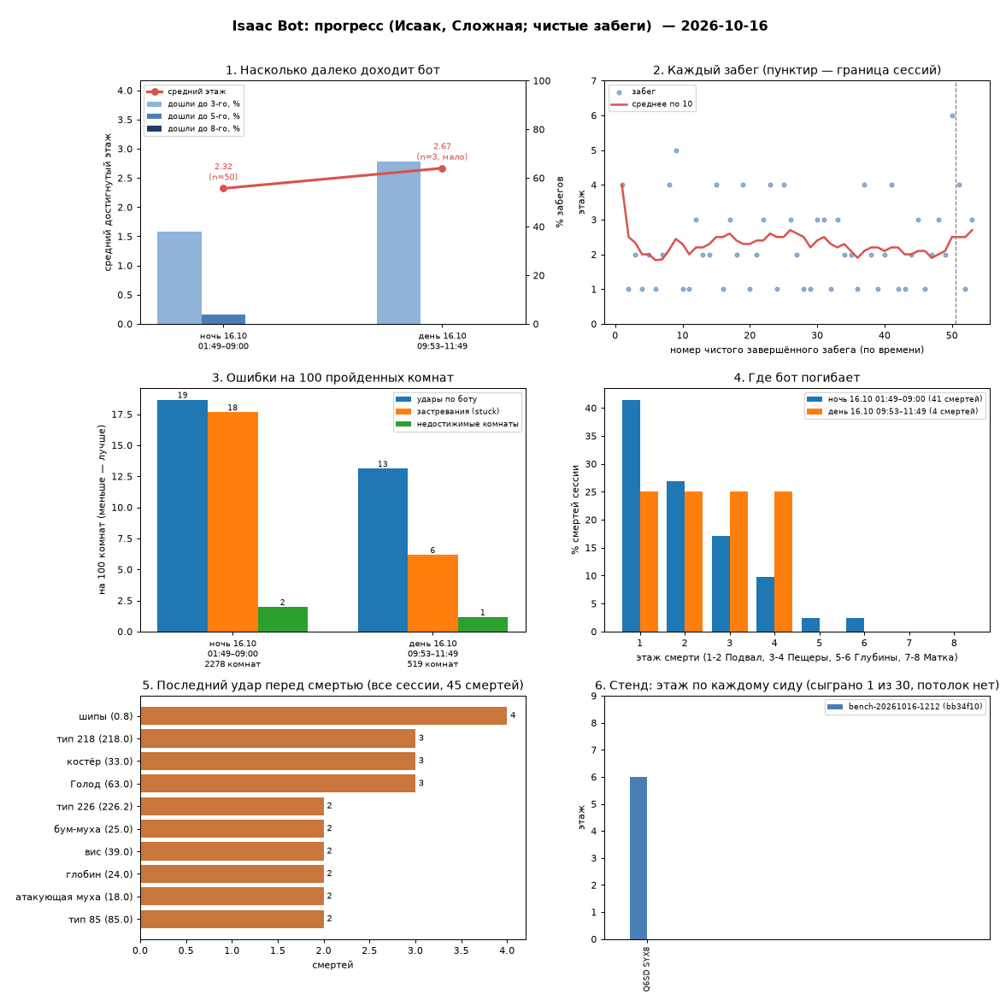

# Isaac Bot: an autopilot for The Binding of Isaac: Repentance+

**English** | [Русский](README.ru.md)

A plain Lua mod (no third-party loader) for Repentance+ v1.9.7.17.J460, offline single-player only.
The bot plays a whole run with any character: it clears rooms, dodges, picks up items and
consumables, walks the floor map and takes the exit that leads to the chosen ending.

## Status: prototype
The bot has not won a clean run yet. First night (Isaac, Hard, 50 clean runs): mean floor reached
2.3, 38% reached floor 3, 4% reached floor 5. The goal for the first version is 10% wins over a
night. Progress per session (built by `tools/progress.py`; chart labels are in Russian):

## Install
1. Mods are enabled in the game (`EnableMods=1` in `options.ini`).
2. Copy the `mod` folder to `<game>\mods\isaac_bot` (or make a symbolic link).
3. Start a normal run; the bot turns itself on. The console takes `restart <character number>`.

## Controls
- `F9`: bot on/off (control returns to the player at once).
- `F8`: the bot menu (mouse). While it is open the game gets no input and its HUD is hidden.
- `F7`: next preset (press again if there are unsaved changes).
- The menu:
  - top: presets (pick from the list, Save, Save as, "…" to rename, reset changes, load at game
    start, delete). Built-in presets: Standard, Speedrun to Mom, Azazel to the Lamb;
  - left: run state, the goal (Mom / Heart / Isaac / Satan / ??? / Lamb / Auto), the character
    (same / cycle / random / a specific one), behaviour switches;
  - right: priority and exclusion lists shown as item pictures (drag to reorder, right click or the
    cross removes), below them a catalog of 721 items with search by number or name (Russian
    layout via the RU/EN button or `Tab`), filters, `+`/`−` buttons per row; `↑/↓`/`PgUp`/`PgDn`
    pick a row, `Enter` adds it to priorities, `Shift+Enter` to exclusions;
  - every setting has a small "?" that explains it.
- The status line at the bottom says what the bot is doing.

The menu text is in Russian.

## What it does
- Room grid, path finding around pits and rocks, bombing rocks, pressing pressure plates.
- Simulates projectiles, bodies and lasers ~0.5 s ahead and picks a safe direction.
- Fights according to the weapon (tears, Brimstone, Tech, Mom's Knife, charge shots), uses actives.
- Values items and pickups, shop prices, traps (hearts for Lost/Keeper and so on).
- Floor room graph: treasure room / shop / library, then the boss, then the trapdoor or the beam of
  light for the goal; Polaroid/Negative are taken into account after Mom's Heart.
- Run statistics, auto restart, character cycling.

## Limits (honestly)
No pills or cards, no secret rooms or crawlspaces, no alternative path (Downpour/Mines,
Mother/Beast), no T.Cain crafting, no special control for T.Forgotten and Jacob & Esau. The bot is
a heuristic, not a guaranteed win: it can die, especially with fragile characters and on later
floors.

## Development
The tools need Python 3.10+ with Pillow and matplotlib. Night runs back up the saves with
`um backup` from [universal-modder](https://github.com/rehan-remade/universal-modder) (without it
use `--no-backup` and copy the saves yourself).

- `python tools/bridge.py "luamod isaac_bot"` reloads the mod in the running game;
  `"restart 7"` starts a new run as Azazel; `"bot goal lamb"`, `"bot status"` change bot settings.
- `python tools/runlog.py`: a report of runs from `log.txt` (floors, deaths, damage, items, stuck).
- `python -I tools/verify_lua.py <file.lua>`: syntax and unknown-global check.
- `python tools/night.py --until 08:00 --char 0`: a night run. Backs up the saves, then a watchdog
  unpauses the game, restarts a stuck run and, if the log goes silent, kills the game by PID and
  relaunches it through Steam (up to 5 times). All events go to `runs/night-*.jsonl`.
- `python tools/nightreport.py`: the morning summary `runs/report-*.md` (clean Hard win rate, mean
  floor reached, share reaching floors 3/5/8, deaths by floor and cause, stuck events, watchdog
  actions).
- `python tools/bench.py [--cap 5] [--n 10] [--tag label]`: the bench, the same 30 seeds
  (`tools/bench_seeds.txt`) as Isaac on Hard, to compare bot versions. Runs in the background and
  leaves the game window alone while you are at the PC. Summary `runs/bench-*.md` with the git
  commit and the per-seed difference to the previous bench. Seeded runs never count as wins.
- `python tools/deathview.py [file.jsonl|log.txt] [--list] [--death N]`: death replays. The mod
  records the last 3 seconds before the killing hit (bot, enemies, projectiles, lasers, the wanted
  and chosen move); a room picture `runs/deaths/*.png` and a per-update timeline of the last second.
- `python tools/progress.py`: progress charts over all sessions and benches, written to
  `runs/progress.png` and `runs/progress.md`.
- The development journal and the verified API facts: `MODLOG.md`.

## How it was made
The idea, requirements and decisions are the author's (netlesha). The code of the mod and the
tools was written and tested in the real game together with the AI assistant
[Claude Code](https://claude.com/claude-code), following the
[universal-modder](https://github.com/rehan-remade/universal-modder) method. Every claim about the
game API was checked in the running game; the log of checks and decisions is `MODLOG.md`.

## Important
The mod does not change or include any game files, does not bypass any protection and does not
work online. The bot plays on your save, so its runs affect your statistics and unlocks. Back up
your saves before the first launch.

## License
MIT, see [LICENSE](LICENSE). The Binding of Isaac belongs to Edmund McMillen and Nicalis; this
project is not affiliated with them.
